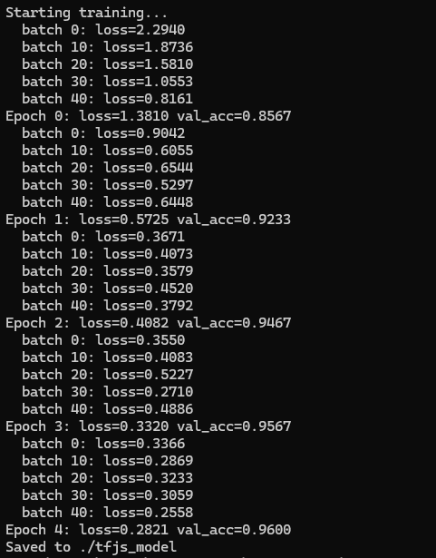

# React + Vite

This template provides a minimal setup to get React working in Vite with HMR and some ESLint rules.

Currently, two official plugins are available:

- [@vitejs/plugin-react](https://github.com/vitejs/vite-plugin-react/blob/main/packages/plugin-react) uses [Oxc](https://oxc.rs)
- [@vitejs/plugin-react-swc](https://github.com/vitejs/vite-plugin-react/blob/main/packages/plugin-react-swc) uses [SWC](https://swc.rs/)

## React Compiler

The React Compiler is not enabled on this template because of its impact on dev & build performances. To add it, see [this documentation](https://react.dev/learn/react-compiler/installation).

## Expanding the ESLint configuration

If you are developing a production application, we recommend using TypeScript with type-aware lint rules enabled. Check out the [TS template](https://github.com/vitejs/vite/tree/main/packages/create-vite/template-react-ts) for information on how to integrate TypeScript and [`typescript-eslint`](https://typescript-eslint.io) in your project.

~~~~~~~~~~~~~~~~~~~~~~~~~~~~~~~~~~~~~~~~~~~~~~~~~~~~~~~~~~~~~~~~~~~~~~~~~~~~~~~~~~~~~~~~~~~~~~~~~~~~~~~~~~~~~~~~~~~~~~~~~~~~~~~~~~~~~~~~~~~~~~~~~~~~~~~~~~~~~~~~~~~

# Digit Recognizer

Draw a digit in the browser and a neural network predicts it in real time,
entirely client-side — no server calls after the page loads.

**[Live demo](https://digit-recognizer-qtj9misho-ri-sing-spire.vercel.app)**

## How it works

A neural network is trained on the MNIST handwritten digit dataset using
TensorFlow.js in Node, then loaded directly in the browser for in-browser
inference. When you draw a digit, the canvas is scanned to find the drawn
strokes, cropped and centered around them, downscaled to 28x28, and fed
into the model — mirroring how the MNIST training images are formatted.

## Stack

- TensorFlow.js — model training (Node) and inference (browser)
- React + Vite
- Deployed on Vercel

## Model

- Architecture: dense neural network (128 → 64 → 10 units, with dropout)
- Trained on a 3,000-example subset of MNIST
- Validation accuracy: ~95.7%

A CNN was the initial approach but was impractically slow to train on
CPU without native TensorFlow bindings, so this uses a dense network
instead — a deliberate tradeoff to keep training time reasonable.

## Known limitations

- Accuracy drops for digits drawn very small, off-center, or with
  unusual stroke thickness, since the training data (synthetic MNIST-
  formatted samples) doesn't perfectly match freehand browser drawing.
  Works best with digits drawn large and roughly centered.
- Trained on a subset of MNIST rather than the full 60,000-image set,
  as a time tradeoff.

## Running locally

\`\`\`bash
npm install
npm run dev
\`\`\`