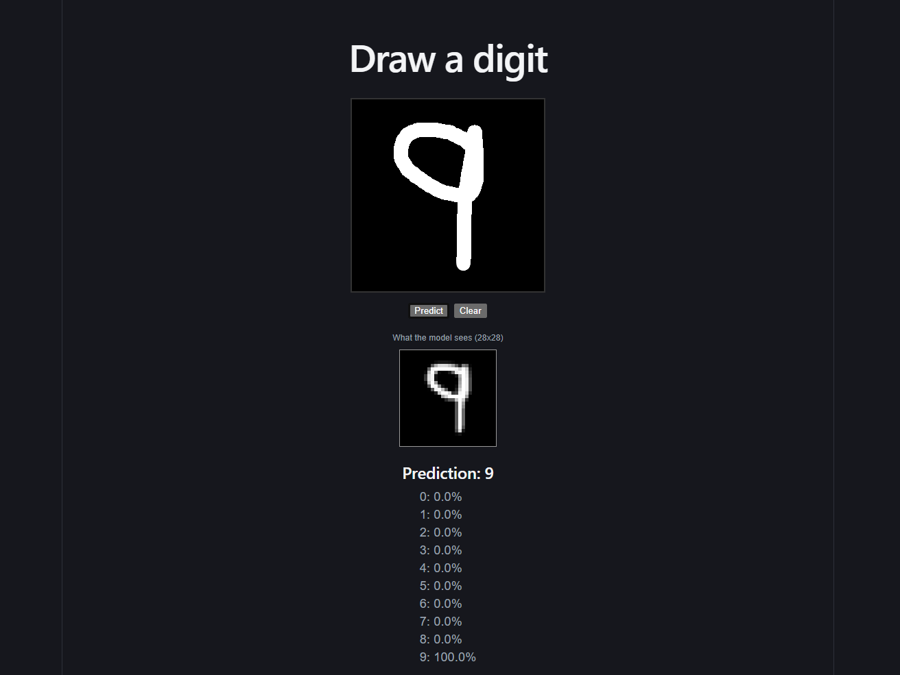

# React + Vite

This template provides a minimal setup to get React working in Vite with HMR and some ESLint rules.

Currently, two official plugins are available:

- [@vitejs/plugin-react](https://github.com/vitejs/vite-plugin-react/blob/main/packages/plugin-react) uses [Oxc](https://oxc.rs)
- [@vitejs/plugin-react-swc](https://github.com/vitejs/vite-plugin-react/blob/main/packages/plugin-react-swc) uses [SWC](https://swc.rs/)

## React Compiler

The React Compiler is not enabled on this template because of its impact on dev & build performances. To add it, see [this documentation](https://react.dev/learn/react-compiler/installation).

## Expanding the ESLint configuration

If you are developing a production application, we recommend using TypeScript with type-aware lint rules enabled. Check out the [TS template](https://github.com/vitejs/vite/tree/main/packages/create-vite/template-react-ts) for information on how to integrate TypeScript and [`typescript-eslint`](https://typescript-eslint.io) in your project.


~~~~~~~~~~~~~~~~~~~~~~~~~~~~~~~~~~~~~~~~~~~~~~~~~~~~~~~~~~~~~~~~~~~~~~~~~~~~~~~~~~~~~~~~~~~~~~~~~~~~~~~~~~~~~~~~~~~~~~~~~~~~~~~~~~~~~~~~~~~~~~~~~~~~~~~~~~~~~~~~~~~

# Digit Recognizer

Draw a digit in the browser and a convolutional neural network predicts it in
real time, entirely client-side. There are no server calls after the page loads.

**[Live demo](https://digit-recognizer-o8buntsr1-ri-sing-spire.vercel.app/)**



## How it works

The model is trained in Python (Keras) on the full MNIST dataset, with data
augmentation so it tolerates imperfectly drawn digits. The trained weights are
exported as a raw binary file plus shape metadata. The web app rebuilds the same
architecture in TensorFlow.js, loads the weights, and runs inference in the browser.

When you click Predict, the canvas is preprocessed to match MNIST formatting:
the drawn strokes are located, cropped to a padded square, centered,
downscaled to 28x28, and normalized.

## Stack

- Keras / TensorFlow (training, in Google Colab)
- TensorFlow.js (in-browser inference)
- React + Vite
- Docker
- Deployed on Vercel

## Model

- Architecture: 2 conv layers (32 and 64 filters, 3x3) with max pooling,
  then a 128-unit dense layer with dropout (0.3) and a 10-way softmax
- Training: 60,000 MNIST training images, 15 epochs, Adam optimizer, with random
  shift, zoom, and rotation augmentation
- Accuracy: 98.97% on the 10,000-image MNIST test set (final epoch)

Note: that accuracy is on standard MNIST digits. Freehand mouse drawing differs
from MNIST, so real-world accuracy in the app is lower.

## Training

The training notebook is in `training/`. It exports `weights.bin` and
`meta.json`, which live in `public/cnn/` and are loaded by the app at startup.

## Known limitations

- Freehand drawings can still be misclassified, since MNIST digits were written
  with pens on paper and then normalized. Works best with large, centered digits.

## Running locally

```bash
npm install
npm run dev
```

## Docker

```bash
docker compose up --build
```

See `README.Docker.md` and `compose.yaml` for the port.